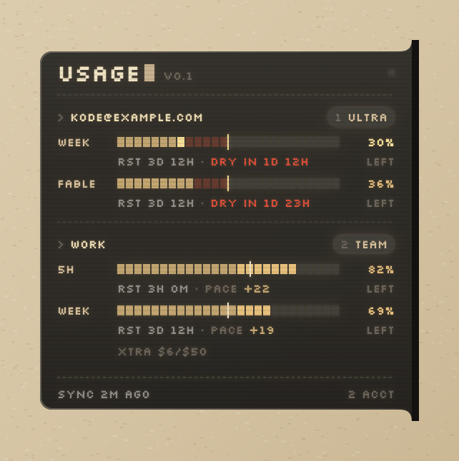
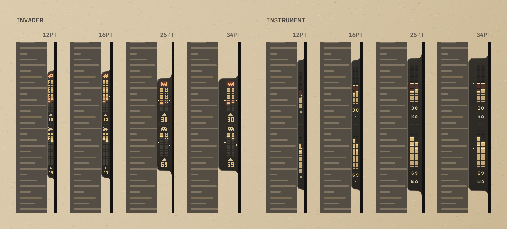
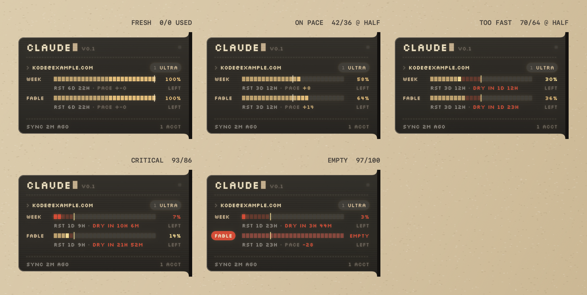

# Usage Invader

[](https://github.com/konstantindenerz/usage-invader/actions/workflows/build.yml)

A small macOS overlay that shows how much of your subscription usage is left, for one or
several accounts, as a pixel strip on the right edge of the screen. Hover the strip and it
expands into a panel with percentages, reset countdowns and your burn pace.

<p align="center">
  
</p>

> Usage Invader is an unofficial tool. It is not affiliated with or endorsed by Anthropic.
> See [Disclaimer](#disclaimer).

## Features

- **All limits at a glance:** current session (5 h), current week, and model-specific weekly limits.
- **Multiple accounts:** every signed-in account on the machine is found automatically.
- **Pace:** shows whether you are ahead of or behind an even burn, and when a limit runs dry
  at the current rate.
- **Stays out of the way:** no Dock icon, a strip of 25.5 pt at the screen edge, plus a menu bar
  item that shows the lowest remaining percentage. A model limit that is used up is skipped
  there, since the other models keep working.
- **Two skins** for the collapsed strip: Invader (default) and Instrument.
- **Read-only and local:** reads the token already stored in your keychain, talks only to
  `api.anthropic.com`, has no third-party dependencies and no telemetry.

## Screenshots

The collapsed strip in both skins, at the widths it can take next to a window:



The expanded panel from a fresh week to an exhausted limit:



All images are rendered from demo data with `--readme-shots`.

## Requirements

- macOS 14 or later
- [Claude Code](https://claude.com/claude-code) ("the CLI" below), signed in at least once (`/login`)
- To build from source: a Swift 6 toolchain (Xcode 16 or later)

## Install

### Download

1. Download `UsageInvader-<version>.zip` from the
   [latest release](https://github.com/konstantindenerz/usage-invader/releases/latest).
2. Unzip it and move `UsageInvader.app` to `/Applications`.
3. The app is ad-hoc signed and not notarized, so Gatekeeper blocks it on first launch.
   Remove the quarantine flag once, then open it:

   ```sh
   xattr -dr com.apple.quarantine /Applications/UsageInvader.app
   open /Applications/UsageInvader.app
   ```

### Build from source

```sh
git clone https://github.com/konstantindenerz/usage-invader.git
cd usage-invader
scripts/run.sh              # builds build/UsageInvader.app and launches it
```

On first launch macOS may ask whether `security` may access the CLI's keychain item.
Choose **Always Allow**; see [Security and privacy](#security-and-privacy) for what that means.

## Usage

### Overlay

The strip sits on the right edge of the screen. Hover it to expand the panel; right-click or
Option-click it to open the menu.

Each account shows its meters with the percentage **left**:

| Element | Meaning |
|---|---|
| `5H`, `WEEK`, model name | Session limit, weekly limit, model-specific weekly limit |
| `RST 3D 12H` | Time until the limit resets |
| `PACE +8` | Percentage points you are ahead of an even burn across the window (negative: too fast) |
| `DRY IN 1D 12H` | When the limit runs out at the current rate, shown if that is before the reset |
| `XTRA $6/$50` | Extra usage credits, if enabled for the account |

### Menu bar

The invader icon shows the lowest remaining percentage across all accounts, skipping model
limits that are used up (the strip's number works the same way). **Left click**
opens the usage panel as a popover, even while the overlay is hidden. **Right click** or
Ctrl-click opens the menu.

### Menu

- One line per account, e.g. `KODE · WEEK 8% left · FABLE 0% left`
- **Refresh now** (⌘R), **Show/Hide overlay**, **Scanlines**
- **Fit to free margin:** make the strip only as wide as the gap next to your windows
  (off by default: full width, may overlap)
- **Style:** Invader or Instrument
- **Screen:** which display the strip sits on (default: the main display)
- **Settings…:** aliases, visibility, order, poll interval (2, 5 or 10 min; default 5), scanlines
- **Launch at login** (only when running from `UsageInvader.app`)
- **Add account…:** instructions and a command to copy

## Multiple accounts

Every config directory of the CLI has its own keychain entry. Usage Invader finds all of them.

To add an account, start the CLI with its own config directory and sign in:

```sh
CLAUDE_CONFIG_DIR=~/.claude-work claude    # then type /login
```

An alias in `~/.zshrc` keeps this handy:

```sh
alias claude-work='CLAUDE_CONFIG_DIR=~/.claude-work claude'
```

The account appears on the next refresh. Give it a name, hide it or reorder it under
**Settings…**.

Accounts are per machine. On another Mac, sign in there; nothing is synced.

## Command line

Run these on the binary, e.g. `build/UsageInvader.app/Contents/MacOS/UsageInvader`:

| Flag | Effect |
|---|---|
| `--demo` | Start with demo data, without polling |
| `--dump` | Print the discovered accounts and their meters, then exit |
| `--snapshot <path.png>` | Render a contact sheet of all scenarios and widths, then exit |
| `--readme-shots <dir>` | Render the README images into a directory, then exit |
| `--diag` | Print bundle paths, font status and the measured free margin, then exit |

`USAGE_INVADER_DEBUG=1` logs hover and layout events to stderr.

## How it works

1. `/usr/bin/security dump-keychain` lists keychain metadata; entries whose service starts with
   `Claude Code-credentials` are the accounts.
2. `/usr/bin/security find-generic-password` reads the OAuth token of each account.
3. The app requests `https://api.anthropic.com/api/oauth/usage` (the source behind the CLI's
   `/usage` command) and, at most once a day, `/api/oauth/profile` for the email and plan.

Requests are budgeted per account: one automatic request per poll interval (never less than
2 minutes apart, also across restarts), and at most one every 20 seconds for **Refresh now** and
`--dump`. After an HTTP 429 the app backs off for 1, 2, 4 … up to 30 minutes and keeps showing
the last values.

Tokens are never refreshed or written. If one has expired, the account is shown as stale; start
`claude` in that account once and the token is renewed.

## Security and privacy

- **Token handling:** the token is read through a pipe, kept in memory, and sent only to
  `api.anthropic.com` over HTTPS. Redirects are refused. It is never logged, cached or written.
- **Local data:** `~/Library/Caches/UsageInvader/` holds the last usage values with the account
  email, name and plan (`last.json`) and the request budget (`fetch-state.json`), readable by
  your user only. Settings live in the `com.kode.usageinvader` defaults domain.
- **Trust model:** once `security` is allowed to read the CLI's keychain item, every
  process running as your user can read that token the same way. The CLI itself relies on
  this; Usage Invader does not widen it.
- **Keychain listing:** discovery reads the metadata (not the secrets) of all keychain items and
  keeps only the matching entries.
- **Window positions:** *Fit to free margin* reads the bounds of on-screen windows. It does not
  read their titles or contents and needs no Screen Recording permission.
- **Build:** no third-party dependencies. The bundle is ad-hoc signed with the hardened runtime
  and is not sandboxed.

## Disclaimer

Usage Invader is not affiliated with or endorsed by Anthropic. Claude is a trademark of
Anthropic. The app relies on an undocumented endpoint and on the credentials the CLI stores
locally; the endpoint may change or stop working at any time. Use it at your own discretion.

## Development

```sh
swift build                 # debug build
scripts/build-app.sh        # release build → build/UsageInvader.app
scripts/run.sh --demo       # rebuild and relaunch with demo data
swift run UsageInvader --readme-shots docs/images   # regenerate the README images
```

| Path | Contents |
|---|---|
| `Sources/UsageInvader/Core` | Models, settings, pace math |
| `Sources/UsageInvader/Data` | Keychain access, usage API, request budget, cache |
| `Sources/UsageInvader/Shell` | App entry, overlay panel, menu bar, settings window |
| `Sources/UsageInvader/UI` | Strip skins, expanded panel, theme, offline renderer |

Every push builds the app in GitHub Actions and attaches the zipped bundle to the run. Pushing
a tag such as `v0.2.0` also publishes it as a release.

## License

[MIT](LICENSE). The pixel font is [Silkscreen](https://fonts.google.com/specimen/Silkscreen),
licensed under the SIL Open Font License (see `Sources/UsageInvader/Resources/OFL.txt`).
